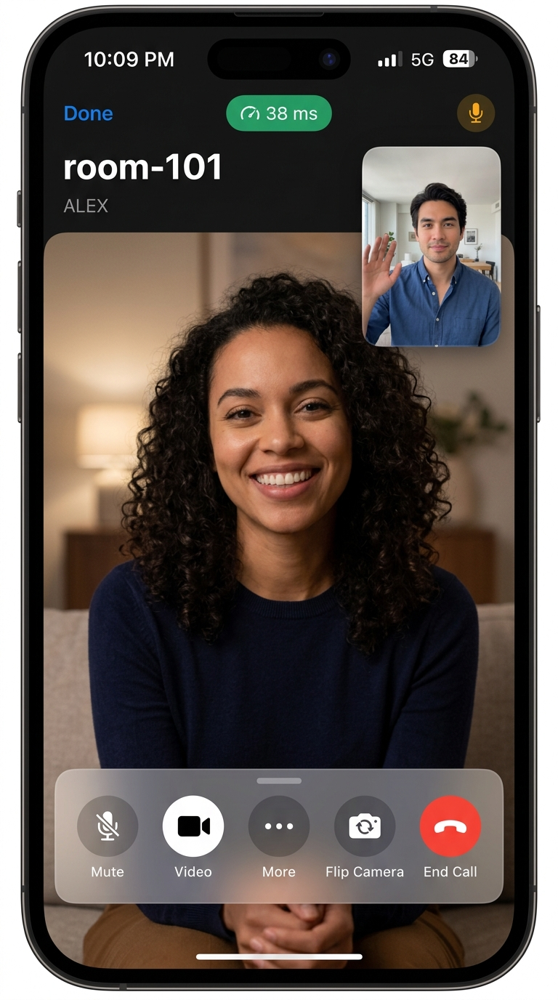
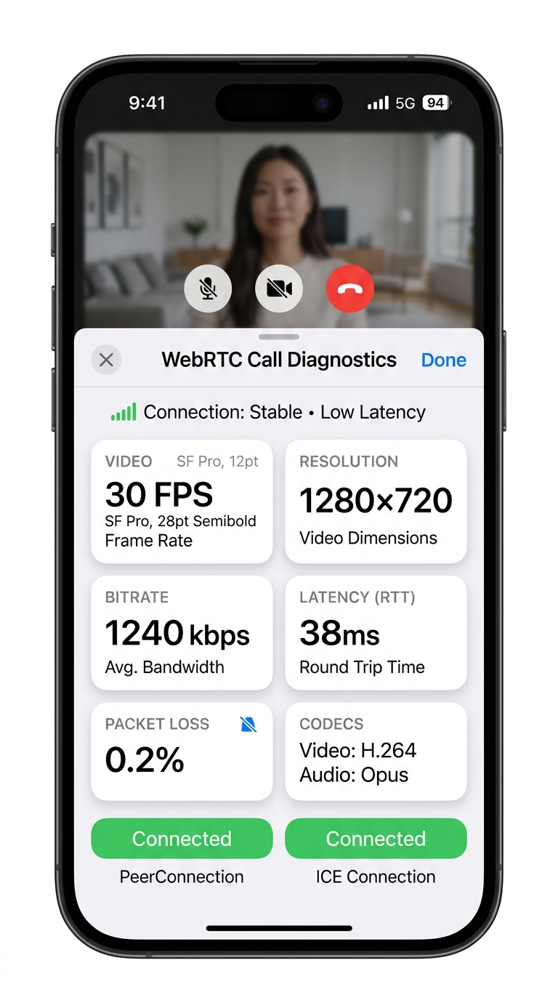

# WebRTCApp — Modern iOS WebRTC Demonstration Sample App

A state-of-the-art, production-grade WebRTC demonstration application for iOS 17.0+, built using **SwiftUI**, **Swift 6 Concurrency**, and **Clean Architecture**.

---

## 📱 App Screenshots

| WebRTC Active Video Call (Dark Mode) | Diagnostics & Stats HUD (Light Mode) |
| :---: | :---: |
|  |  |

---

## ✨ Key Features

- **P2P Audio & Video Calling**: Real-time peer-to-peer media streaming with camera switching (front/back), video toggling, microphone muting, and speakerphone routing.
- **Adaptive Dark & Light Modes**: Curated dynamic color palettes, semantic system surfaces, and glassmorphic materials (`.ultraThinMaterial`) that automatically adapt to system appearances.
- **Dynamic Type & Accessibility**: All typography, badges, and layout metrics scale fluidly with iOS Dynamic Type and Accessibility text size options without truncation or clipping.
- **Orientation Responsive**: First-class support for both **Portrait** (full-screen remote feed with draggable Picture-in-Picture local camera) and **Landscape** (side-by-side feed layout with accessible side controls).
- **Real-Time DataChannel Chat**: Out-of-band peer-to-peer text messaging over SCTP WebRTC DataChannel with message bubbles and live connection indicators.
- **Diagnostics HUD**: Live WebRTC statistics displaying:
  - Frame rate (FPS) and video resolution (e.g., 720p @ 30fps)
  - Bitrate (kbps) and bandwidth consumption
  - Round Trip Time (RTT latency in ms) and packet loss percentage
  - Active audio/video codecs (Opus, H.264)
  - Detailed PeerConnection and ICE state machine metrics
- **Three Signaling Modes**:
  1. **Loopback Mode (Local Demo)**: Instant 1-device demonstration. Simulated peer automatically responds to offers and echoes DataChannel messages—no external server needed!
  2. **WebSocket Server**: Connects over WebSocket to a standard room-based WebRTC signaling server for multi-device testing.
  3. **Manual SDP (Air-Gapped)**: Copy/paste or export/import SDP offers, answers, and ICE candidates directly between devices.
- **Push Safe**: Zero hardcoded API keys, private tokens, or secrets. Proper `.gitignore` pre-configured for clean GitHub repository sharing.

---

## 🏛 Clean Architecture & Design

WebRTCApp adheres to SOLID principles and Clean Architecture to ensure separation of concerns and high testability:

```text
WebRTCApp/
├── Domain/                         # Enterprise Business Rules & Models
│   ├── Models/                     # SessionDescription, IceCandidate, SignalingMessage, ConnectionStats
│   ├── Interfaces/                 # WebRTCClientProtocol, SignalingClientProtocol, AudioSessionManagerProtocol
│   └── UseCases/                   # Call action coordination
├── Data/                           # Data Sources & Adapters
│   ├── Audio/                      # AVAudioSession management (.videoChat, speaker override)
│   ├── Signaling/                  # WebSocket, MockLoopback, and Manual signaling implementations
│   ├── WebRTC/                     # Native WebRTC client adapter & high-fidelity SimulatedWebRTCClient
│   └── Repositories/               # CallRepository coordinating signaling and peer connection handshakes
└── Presentation/                   # User Interface & Interaction
    ├── Theme/                      # AppColors, AppTypography (Dynamic Type), AppSpacing tokens
    ├── ViewModels/                 # CallViewModel (@Observable, @MainActor)
    └── Views/                      # MainCallView, VideoStreamView, CallControlsBar, Sheets (Chat, Stats, Settings)
```

---

## 🛠 Technical Specifications

- **Minimum Deployment Target**: iOS 17.0
- **Language**: Swift 6.0 / Swift 5.0 (Strict Concurrency compatible)
- **UI Framework**: SwiftUI
- **State Management**: Observation framework (`@Observable`)
- **Supported Devices**: iPhone & iPad
- **Orientations**: Portrait, Landscape Left, Landscape Right

---

## 🧪 Testing Suite

The project includes an exhaustive testing suite located in `WebRTCAppTests`:

1. **Unit Tests (`UnitTests/`)**:
   - `SignalingMessageTests.swift`: Comprehensive JSON encoding and decoding tests for SDP offers, answers, and ICE candidates.
   - `SignalingClientTests.swift`: Connection lifecycle and automatic offer-answer loopback response tests.
   - `WebRTCClientTests.swift`: PeerConnection lifecycle, media settings mutation, and DataChannel echo messaging tests.
   - `CallViewModelTests.swift`: State machine transitions, media toggles, and view model event publishing tests.
2. **Integration Tests (`IntegrationTests/`)**:
   - `CallIntegrationTests.swift`: Full simulated 2-peer call handshake (Peer A creates Offer $\rightarrow$ Signaling $\rightarrow$ Peer B receives Offer, creates Answer $\rightarrow$ Signaling $\rightarrow$ Peer A receives Answer $\rightarrow$ ICE Connected $\rightarrow$ DataChannel transmission).
3. **Snapshot Tests (`SnapshotTests/`)**:
   - `ViewSnapshotTests.swift`: Layout validation for Light Mode, Dark Mode, Portrait, Landscape, and Dynamic Type accessibility scale (`.accessibility3`).

### Running Tests in Xcode

1. Open `WebRTCApp.xcodeproj` in Xcode.
2. Select the `WebRTCApp` scheme.
3. Press `Cmd + U` to execute all unit, integration, and snapshot tests.

---

## 🚀 Getting Started

1. **Clone the repository**:
   ```bash
   git clone https://github.com/your-username/WebRTCApp.git
   cd WebRTCApp
   ```
2. **Open in Xcode**:
   ```bash
   open WebRTCApp.xcodeproj
   ```
3. **Run on Simulator or Device**:
   - Select your desired iOS Simulator (e.g., iPhone 15 Pro / iPhone 16) or physical iPhone.
   - Press `Cmd + R` to build and run.
   - By default, the app launches in **Loopback (Local Demo)** mode so you can tap **Start Call** immediately and see live video feeds, real-time statistics, and chat over DataChannel!

---

## 📄 License

This project is released under the [MIT License](LICENSE).
